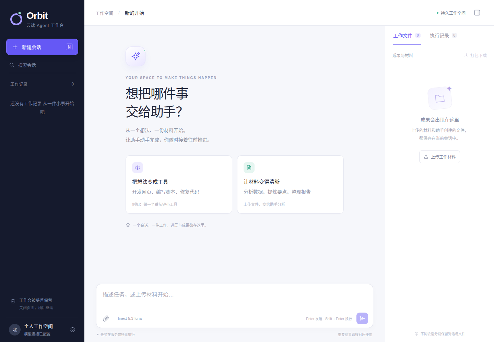

# Orbit · 云端 Agent 助手工作台

把工作交给助手，看到它实际执行，拿到成果，再接着修改。基于 **OpenCode CLI 1.2.27 + FastAPI + SQLite**，通过 Docker 提供单用户浏览器工作台，接入真实的 OpenAI 兼容模型 API。



[演示视频](docs/evidence/orbit-demo.webm) · [实际生成的网页](docs/evidence/generated/code/index.html) · [分析报告](docs/evidence/generated/work/report.md) · [验证证据](docs/VALIDATION.md)

## 启动

只需 Docker Engine，无需在宿主机安装 Node、Python、Agent CLI 或 Compose。

```bash
git clone https://github.com/changzhaoxun-wq/talkingdata.git
cd talkingdata
cp .env.example .env
chmod 600 .env
```

编辑 `.env`，填入平台的临时凭据和可用模型名：

```dotenv
AGENT_BASE_URL=https://showmevibecode.up.railway.app/api/model/v1
AGENT_API_KEY=填写自己的临时凭据
AGENT_MODEL=填写平台返回的模型名
PORT=8787
```

```bash
bash scripts/start.sh
```

打开 **http://localhost:8787**。首次构建需要下载依赖。也可先不填凭据启动，再从左下角「个人工作空间」保存模型连接并检测；模型名留空时自动选择平台 `/models` 返回的第一个模型。

Docker 位于远程开发机时，用 VS Code 端口转发，或在自己的电脑执行：

```bash
ssh -L 8787:127.0.0.1:8787 用户名@开发机地址
```

然后在自己电脑的浏览器打开 `http://localhost:8787`。应用只绑定宿主机回环地址。

有 Compose 插件也可用 `docker compose up --build -d`。两种启动方式使用各自命名卷，请选择一种持续使用。

## 使用方式

1. 新建会话并描述目标。助手实际运行工具、读写文件。页面关闭后，服务端任务继续执行。
2. 附件按钮或拖放上传材料，单文件最多 25 MB。文件保存在本会话的 `uploads/` 中。
3. 右侧「执行记录」展示真实工具输入、输出和状态；「工作文件」提供预览、单文件及 ZIP 下载。
4. HTML 成果可点击「运行预览」，在隔离 iframe 中交互。多文件项目下载后按成果说明运行。
5. 提出修改意见时复用本会话的 CLI session ID、上下文和文件。不同会话保留各自工作，可并行推进。
6. 点击「停止」终止当前任务，已有文件保留。失败或中断后可发送新消息继续。点击顶部标题重命名，垃圾桶按钮删除会话及文件。

支持文本、Markdown、CSV、图片、PDF、DOCX、XLSX 预览，容器内提供文档读取库。未发送草稿保存在当前浏览器标签页；已发送对话、事件、CLI 会话及文件保存在服务端命名卷。

## 配置与运维

| 变量 | 默认值 / 用途 |
| --- | --- |
| `AGENT_BASE_URL` | 平台 `/api/model/v1`，需兼容 `/chat/completions` 和 `/models` |
| `AGENT_API_KEY` | 仅用于本应用内 Agent 运行、联调与演示 |
| `AGENT_MODEL` | 平台模型标识，可通过设置页检测 |
| `AGENT_REASONING_EFFORT` | `low`，兼容 provider 的推理强度 |
| `AGENT_MAX_OUTPUT_TOKENS` | `32768`，包含推理消耗，受 CLI 和平台上限约束 |
| `MAX_CONCURRENT_RUNS` | `2`，同会话最多一个任务，其余任务排队 |
| `RUN_TIMEOUT_SECONDS` | `900`，超时终止进程组，保留文件 |
| `PORT` | `8787`，容器内部端口为 `8080` |

设置页保存的服务端配置优先于环境变量。Key 不会从设置接口返回；留空表示保留已存凭据。`.env` 被 Git 与 Docker 构建上下文忽略；设置页凭据保存在数据卷的 `settings.json`，权限为 `0600`。不要发布自己的数据卷或备份。

修改代码或 `.env` 后：

```bash
bash scripts/restart.sh
docker logs --tail 100 talkingdata-workbench
docker inspect --format '{{.State.Health.Status}}' talkingdata-workbench
```

暂停与再次启动：

```bash
docker stop talkingdata-workbench
docker start talkingdata-workbench
```

启动脚本使用 `talkingdata-workbench-data` 命名卷。删除容器不清除记录；删除该卷会清除会话、文件及设置。运行容器以 UID 10001 执行，限制为 2 CPU、2 GiB 内存、256 个进程，删除额外 Linux capabilities，不挂载 Docker socket 或宿主机项目目录。

## 架构与取舍

浏览器通过 FastAPI 提交任务。SQLite WAL 保存会话、消息、任务与带序号的事件。后台调度器启动真实的 `opencode run --format json`，任务通过标准输入传入；后续显式使用 `--session`，不会错误接入其他会话。

OpenCode 的 `@ai-sdk/openai-compatible` provider 直接调用平台 Chat Completions API，支持流式工具调用。每个会话有独立工作目录和 CLI 数据目录。SSE 使用事件 ID 重放，断线重连不重新提交任务。界面显示 CLI 实际输出的文本段落与工具完成事件，不是逐 token 输出。

任务状态为 `queued / running / completed / failed / cancelled / interrupted`。取消和超时终止进程组；重启将遗留的排队、运行任务标记为中断，不静默重放有副作用的操作。模型以 `length` 等不完整原因结束时显示失败，不把正常退出码直接等同于任务完成。

```text
app/                  API、SQLite、文件与真实 CLI 调度
web/                  无需构建的浏览器界面、本地 Markdown 渲染与净化依赖
scripts/              Docker 启停、测试与真实演示
tests/                不消耗模型额度的生命周期与文件边界测试
demo/materials/       虚构销售数据及分析任务材料
docs/evidence/        实际截图、录屏、事件与 Agent 生成成果
Dockerfile            固定基础镜像摘要与 CLI 版本，多阶段构建
compose.yaml          可选 Compose 启动配置
```

## 演示与验证

见 [演示步骤及成果](docs/DEMO.md) 和 [实际验证记录](docs/VALIDATION.md)。

无需凭据的测试：

```bash
bash scripts/test.sh
```

测试在断网容器中使用明确标注的 CLI 替身检查生命周期；替身不进入应用运行路径。真实 CLI 和模型调用另有完整证据，不将替身测试当作真实联调成功。

重做浏览器真实演示（会创建两个会话并调用模型）：

```bash
python3 -m venv .venv
.venv/bin/pip install -r requirements-dev.txt
.venv/bin/python -m playwright install chromium --only-shell
.venv/bin/python scripts/demo.py --base-url http://127.0.0.1:8787
```

## 已知限制

- 面向可信单用户，没有账户或多人权限，不应暴露公网。会话目录是逻辑分区，不是独立安全容器；Agent shell 以同一容器用户运行，不适合恶意任务或攻击性材料。
- 当前只支持 Chat Completions 兼容接口；仅提供 Anthropic Messages 或 Responses 的服务需另加适配。临时凭据过期、限流、额度及网络故障会显示错误，可更新配置后继续。
- 每次上传最多 20 个、合计 100 MB；列表最多 1000 项，打包最多 150 MB。隐藏文件、依赖目录和符号链接不会通过文件接口暴露。
- HTML 预览允许内联脚本与下载，不提供同源权限或外部资源，不能作为完整多文件开发服务器。执行过程中获取文件可能读到中间版本，建议完成后下载。
- 重启不自动重跑。最后一个被强制中断的 CLI 步骤可能只有部分上下文。只支持一个 Uvicorn worker；横向扩展需要独立队列与 worker 管理。
- 没有会话级资源或网络出口隔离，Agent 可联网安装依赖。扫描 PDF 需额外 OCR；预览有页数及文本长度限制。

第三方前端依赖版本、校验值及许可证见 [web/vendor](web/vendor)。OpenCode 来源：[官方项目](https://github.com/anomalyco/opencode/tree/v1.2.27)。
