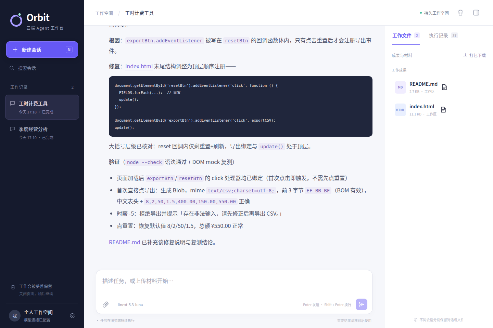
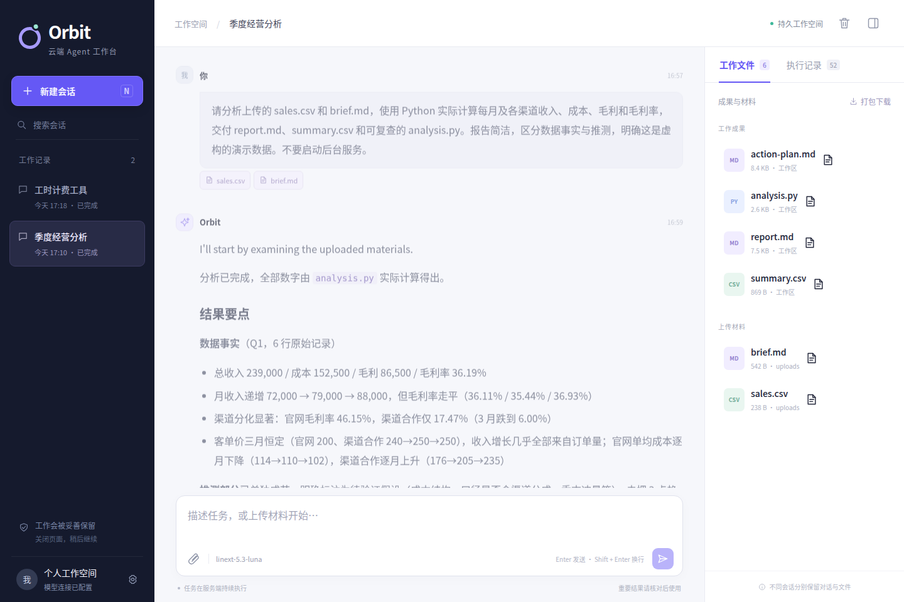

# 实际演示

以下任务通过 Docker 应用、OpenCode 1.2.27 和平台模型 `linext-5.3-luna` 完成。销售材料为仓库自带的虚构样例。助手回复与工具记录均来自实际调用。

## 开发代码并继续修改

新建「工时计费工具」会话，交付可离线使用的工时计费网页，支持正常工时、加班工时、时薪、加班倍数及输入校验。

在右侧查看工具执行和生成文件。完成后继续要求增加中文表头、UTF-8 BOM 的 CSV 导出，助手复用同一 CLI 会话修改已有文件。

- [完整对话与执行事件](evidence/code-transcript.json)
- [实际生成的网页](evidence/generated/code/index.html)
- [成果说明](evidence/generated/code/README.md)

## 上传材料、分析并补充行动计划

在代码任务执行期间，打开另一会话，上传 [sales.csv](../demo/materials/sales.csv) 和 [brief.md](../demo/materials/brief.md)。请助手使用 Python 实算月度、渠道收入、成本、毛利与毛利率，输出报告、CSV 和计算脚本。

切回代码会话，再关闭页面并重新打开，检查后台任务和之前工作仍保留。分析完成后继续要求给出 30 天行动计划，标注负责人角色、时间和验收指标，更新原报告链接。

- [完整对话与执行事件](evidence/work-transcript.json)
- [经营报告](evidence/generated/work/report.md)
- [汇总 CSV](evidence/generated/work/summary.csv)
- [计算脚本](evidence/generated/work/analysis.py)
- [后续行动计划](evidence/generated/work/action-plan.md)

## 证据索引

- [运行结果摘要](evidence/demo-results.json)：真实任务状态、模型、工具调用次数、续聊和浏览器检查。
- [初始界面](evidence/01-workspace.png)、[代码执行中](evidence/02-code-running.png)、[材料执行中](evidence/03-materials-running.png)、[重新打开页面](evidence/04-reconnected.png)。
- [移动端截图](evidence/07-mobile.png)。
- [实际工作台录屏](evidence/orbit-demo.webm)，成果交互与运算检查见 [验证记录](VALIDATION.md)。

复现命令见主 README。`scripts/demo.py` 使用真实浏览器操作应用，会创建会话、上传材料、发起任务、提出修改并保存证据。
