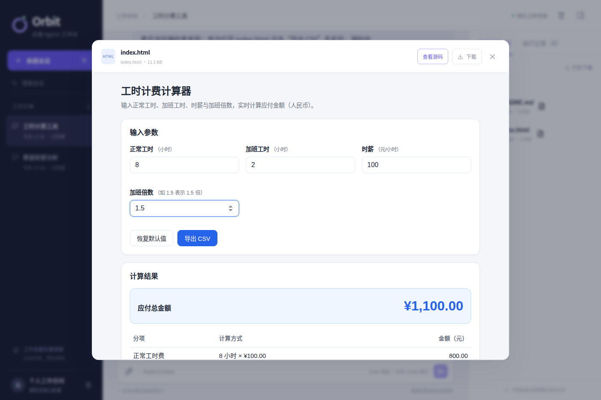

# 实际运行与验证记录

验证日期：2026-11-21（Asia/Shanghai）。应用在 Docker 中运行，浏览器入口为 `http://localhost:8787`。模型凭据仅用于本应用内 Agent 执行和演示，没有用于实现工作台源码。

## 结果

| 检查 | 实际结果 | 原始证据 |
| --- | --- | --- |
| 真实 Agent CLI | OpenCode 1.2.27；真实调用平台 `linext-5.3-luna` | [容器与运行检查](evidence/runtime-checks.json) |
| 代码开发 | HTML 工时计算器、说明，后续增加并修正 CSV 导出 | [代码会话](evidence/code-transcript.json)、[网页成果](evidence/generated/code/index.html) |
| 材料分析 | 读取上传材料，运行 Python，生成报告、汇总和行动计划 | [分析会话](evidence/work-transcript.json)、[报告](evidence/generated/work/report.md) |
| 续聊 | 两个会话各完成三次真实任务；复用各自 CLI session ID | [六次任务结果与 71 次工具调用](evidence/demo-results.json) |
| 并行与页面恢复 | 两个初始任务同时推进；关闭页面后重新打开，任务继续 | [浏览器演示脚本](../scripts/demo.py)、[重连截图](evidence/04-reconnected.png) |
| 真实 Docker 重启 | 会话、消息 ID、任务 ID、CLI ID 及每个文件 SHA-256 均未改变 | [重启前后核验](evidence/runtime-checks.json) |
| SSE 重连重放 | 查询游标、`Last-Event-ID` 两种方式均从下一条事件恢复 | [运行检查](evidence/runtime-checks.json) |
| 自动化测试 | **19 passed**；在断网测试容器运行 | [测试原始日志](evidence/unit-tests.log) |
| 浏览器检查 | 无页面异常；移动端无横向溢出 | [演示结果](evidence/demo-results.json)、[成果检查](evidence/artifact-checks.json) |

## 独立检查成果，而非只接受助手的完成声明

网页在工作台的隔离预览中实测：正常 8 小时、加班 2 小时、时薪 100、加班倍数 1.5，应付 **1,100.00 元**。负数输入被拒绝，恢复默认值后为 550.00 元。首次打开不经过重置即可下载 CSV，下载内容含 UTF-8 BOM 和正确金额。



分析的 12 行汇总数据逐项与原始 6 行材料独立计算比对，检查收入、成本、毛利、毛利率、订单数、客单价和单均成本。季度收入 239,000，成本 152,500，毛利 86,500，毛利率 36.19%。在无网络、只读挂载输入的独立容器中重新运行 Agent 生成的 `analysis.py`，产生的 CSV 与交付文件逐字节一致：[复算日志](evidence/analysis-reproduction.log)。

浏览器还检查了 Markdown 中脚本与事件属性被净化、隔离 HTML 不能读取父页面 DOM，以及报告和 CSV 的实际预览。检查实现见 [verify_demo.py](../scripts/verify_demo.py)。

## 发现的问题及处理

真实联调没有只保留成功截图：

1. 初次模型输出预算为 8,192，推理耗尽预算，CLI 仍正常退出。修正应用：使用较低推理强度及更充足输出预算，并将 `length` 等非完整结束原因判为失败。回归测试覆盖该情况。
2. 同文档页内链接变化没有加载对应会话。加入 `hashchange` 路由处理，并验证刷新与返回会话。
3. HTML `srcdoc` 会继承父页面严格 CSP，不能直接运行内联脚本。改为独立 HTML 预览响应，使用专用 CSP 和 opaque-origin sandbox；主界面不放宽脚本策略。
4. 真实报告中出现「客单价完全不变」与表格不一致。通过应用续聊让 Agent 按原始数据修正，保留完整反馈记录。
5. 真实网页初次点击导出没有反应，独立浏览器检查发现事件绑定嵌套在重置回调。通过应用继续反馈，让 Agent 修复，再实际下载并核验 BOM 与数据。源码和完成记录中均保留这次修正。

后两项属于 Agent 交付内容的质量问题，展示了用户核验成果、提出反馈并继续推进的完整过程。

## 演示视频

[下载 / 播放实际工作台录屏（WebM）](evidence/orbit-demo.webm)

视频是**已完成真实任务的界面回看**，展示对话、工具记录、网页计算与 CSV 导出、经营报告、行动计划、刷新恢复和移动端切换，不冒充完整任务耗时的实时录像。完整执行时间和工具输入输出以会话 JSON 为准。录屏时长、分辨率见 [视频元数据](evidence/video-metadata.json)，生成脚本见 [record_demo.py](../scripts/record_demo.py)。

## 复现

```bash
# 无模型调用的自动化测试
bash scripts/test.sh

# 在已配置的工作台上执行真实演示，会使用模型额度
.venv/bin/python scripts/demo.py

# 独立检查已有成果，不调用模型
.venv/bin/python scripts/verify_demo.py

# 检查事件重放并重启本项目容器，任务必须先结束
.venv/bin/python scripts/verify_runtime.py --restart

# 回看已有会话并录制视频，不调用模型
.venv/bin/python scripts/record_demo.py
```

测试中有一条第三方 Starlette 关于 httpx TestClient 的弃用提示，不影响当前 19 项测试通过。GitHub Actions 配置了同样的无凭据 Docker 构建与断网测试；此记录的通过结论来自本机实际运行日志，未将尚未观察到的云端 CI 状态当作已通过。
